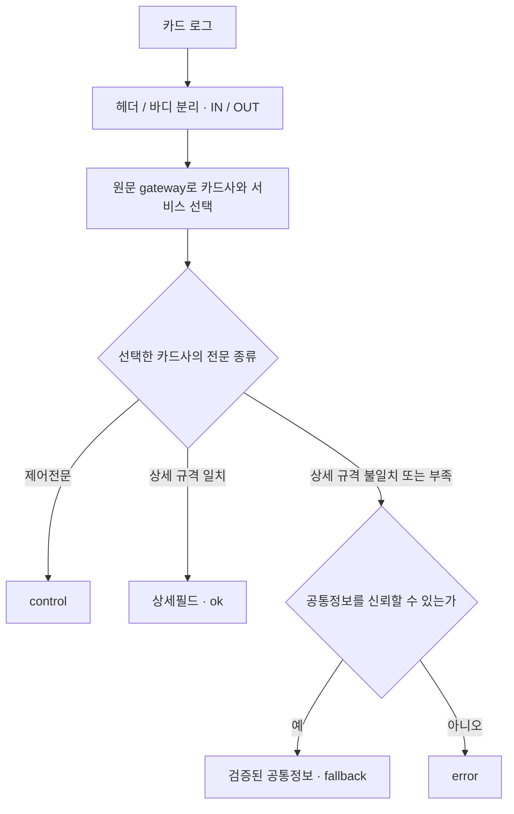

# CARD 파서 FINAL19 적용 안내

버전: `2026-11-04.final19`. 파일명으로 카드사를 선택하지 않습니다.

## 처리 순서

1. 기존 방식으로 logger 헤더와 전문 바디를 나누고 get/put을 IN/OUT으로 표시합니다. 문자형 get/put, put_msg_complete[...], IC HEX의 [S]/[R] 형식을 처리합니다.
2. 원래 message의 헤더 gateway로 JSON의 카드사·IC/MS/통합 프로필을 선택합니다. 헤더가 있으면 파일명, 파일 경로, 잘못 들어온 기존 alias보다 우선합니다.
3. 선택한 카드사의 헤더·MTI·비트맵 또는 고정전문 종류와 가변 길이에 따라 상세 규격을 찾습니다.
4. 해당 상세 규격을 끝까지 해석하면 ok, 상세 해석이 어렵지만 검증 가능한 공통정보가 있으면 fallback입니다. 오류가 발생한 상세값은 남기지 않습니다.
5. 너무 짧거나 필수 공통값·비트맵 등이 손상되어 신뢰할 수 있는 정보가 없으면 error입니다. 알려진 제어전문은 control을 유지합니다.

BGF의 ‘상세 규칙 적용 후 공통 fallback’ 원칙을 카드 데이터에 적용했습니다. 카드사 식별은 gateway 조회 한 번으로 끝내고, 선택한 카드사 안에서 상세 형식을 구분합니다.



## 적용

카드 전문을 처리하는 기존 Ruby 필터 자리에서 RB와 JSON 두 파일을 함께 교체합니다. 카드사별 파일명/경로로 alias를 정하던 분기는 제거하고 첨부 GATEWAY_ROUTING_REPLACEMENT.conf.txt의 Ruby 필터 한 개를 사용합니다. 다른 서비스의 분기까지 지우는 작업은 아닙니다.

```logstash
ruby {
  id => "card_detail_parser"
  path => "${CARD_PARSER_DIR}/card_detail_parser.rb"
  script_params => {
    "specs_path" => "${CARD_PARSER_DIR}/card_detail_specs.json"
  }
}
```

Filebeat의 encoding: euc-kr와 JSON의 text_encoding: CP949는 유지합니다. 기존 운영 input/output과 금액의 숫자 변환도 유지합니다. 파이프라인을 재시작해 두 파일을 다시 읽힙니다. ZIP의 reference/card.conf는 전체 참고 구성이며, 운영 input/output을 대체하는 용도가 아닙니다.

참고 conf에서는 같은 일을 하던 문자형 헤더/바디 분기 두 개를 하나로 합쳤습니다. 닫는 대괄호를 기준으로 바디를 자르지 않아 전문 뒤 linename이 응답코드나 참조번호에 섞이는 문제를 방지합니다. linename은 기존 message/b_body에 보존됩니다. 원문 message도 변경하지 않습니다.

JSON gateways에 현재 운영 gateway를 정의합니다. 신규 gateway가 목록에 없으면 unconfigured이며, 파일명으로 추측하지 않습니다. 헤더와 gateway가 없는 payload-only 시험에서는 명시한 target_alias를 사용할 수 있습니다. 운영 분류는 원문 헤더를 사용합니다.

## 상태의 의미

| 상태 | 처리 |
| --- | --- |
| ok | 선택한 상세 규격을 해석했습니다. 기존 농협의 승인된 rest 정책도 포함합니다. |
| fallback | 규격 차이·길이 부족·인코딩 손실 등으로 상세 해석이 어려워, 확인된 공통정보만 남깁니다. error 태그를 함께 붙이지 않습니다. |
| error | 필수 공통값 손상, 해석 불가능한 헤더/비트맵, 심한 잘림 등으로 안전하게 복구할 수 없습니다. 업무 필드·EMV·rest를 출력하지 않습니다. |
| control | 알려진 제어/상태확인 전문입니다. 종류·방향을 남기며 거래금액 등 업무 필드는 만들지 않습니다. |

error는 결제가 거절됐다는 뜻이 아닙니다. 거절 응답도 규격대로 해석되면 ok입니다. fallback의 errors.code는 상세 파싱을 멈춘 원인을 설명하는 진단일 수 있으며, 최종 분류는 status와 tags로 확인합니다.

공통정보의 범위도 구분해야 합니다. 보통은 거래구분·금액·일시 등 확인된 공통 업무 필드를 남기지만, 내부 규격을 모르는 완전한 헤더 형식은 카드사·서비스·gateway·방향·MTI 또는 전문 종류만 남길 수 있습니다. 그런 경우 금액이나 응답코드 위치를 임의로 만들지 않습니다.

## 이번 보완과 범위

- 새 롯데 IC 실로그는 GILTC_X25A_P01이며, 기존 IC 이름의 MS 첨부는 GCLTC_X25A_P01입니다. 기존 롯데 IC의 문자형 정의를 IC 문서의 BCD·9바이트 User Area·최대 3단 비트맵으로 수정했습니다. 롯데 MS 정의는 유지했습니다.
- 롯데 IC의 가변필드는 길이값을 읽습니다. Track2의 평문 BCD와 문서의 48바이트 암호화 형식을 구분합니다. 카드번호·Track2·PIN 등은 별도 업무 필드로 출력하지 않습니다.
- 롯데 IC DE48 수수료는 문서의 ASCII 두 자리 길이와 실로그의 1바이트 길이를 모두 처리합니다. 실로그 11,368건에서 1바이트 길이 4 + 수수료 ASCII 4자리 + 다음 통화코드 위치를 대조했습니다.
- BC MS의 BCB0480/0481은 인증 문서의 일반 인증/현장 할인 상세 규칙을 적용합니다. BCA/EPT 662건은 내부 상세 규격을 확정하지 못해 검증된 외부 공통 헤더만 남기고 fallback입니다.
- BC IC 구형 ISO 0540/0550 42건은 문서에서 확인한 6바이트 금액 공통 규칙까지만 해석하고 fallback입니다. BCINTMSG0001 본 규격의 금액 길이는 바꾸지 않았습니다.
- 국민 MS의 비 ISO ISP/CCNBCCRDISP 6건은 관측된 접두어·길이·숫자 영역·방향을 확인한 형식만 헤더 공통정보 fallback입니다. 내부 업무 규격이 확인됐다는 뜻은 아닙니다.
- 농협은 기존대로, 정의된 상세필드를 모두 해석한 뒤 남는 데이터를 rest HEX에 묶고 ok로 둡니다. 필드 도중의 잘림이나 손상까지 rest로 넘기지는 않습니다. 다른 카드사에 rest 정책을 확대하지 않았습니다.
- 인코딩이 원복되지 않을 때 온전히 읽힌 바이트 접두부까지만 사용합니다. 공통값을 확보하면 fallback이고, 그 전에 손상됐으면 error입니다. 선언된 전문 길이 밖 logger 버퍼의 손상은 유효 전문 파싱에 영향을 주지 않도록 처리합니다.

공개 진단은 minimal입니다. parser_version은 @metadata에 두고 bitmap·consumed_bytes 같은 진단 필드는 기본 출력하지 않습니다. JSON은 register 시 한 번 읽어 검증·준비·동결하며, 이벤트마다 파일/네트워크를 읽지 않습니다.

카드사별 수치와 지원 한계는 VALIDATION_FINAL19.md, BC 필드는 BC_FIELDS_FINAL19.md, 롯데 IC 필드는 LOTTE_IC_FIELDS_FINAL19.md를 참조합니다.
