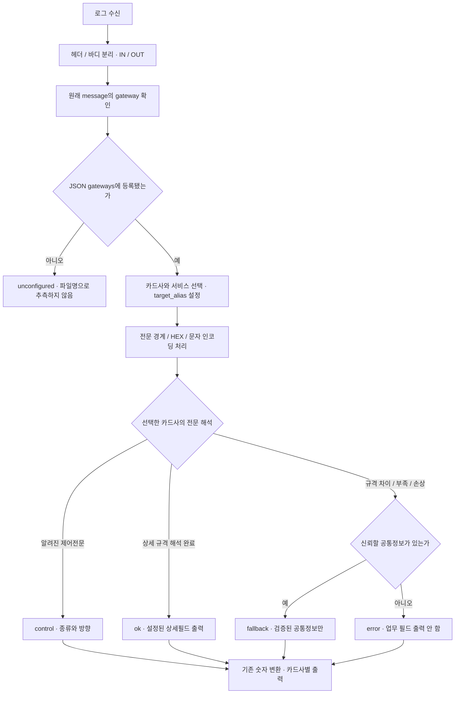

# CARD 처리 흐름 변경 — FINAL18 → FINAL19

제공 버전: `2026-11-04.final19`. RB와 JSON을 함께 교체하고, 카드 전문 처리 영역에서 기존 파일 경로별 alias 분기를 제거합니다. 운영 input/output과 금액 변환은 기존 정책을 유지합니다.

## 이전 GitHub 본문과 달라진 점

| 단계 | 이전 FINAL18 구성 | 현재 FINAL19 구성 |
| --- | --- | --- |
| 카드사 선택 | conf가 `log.file.path`에서 G/W 이름을 찾아 alias 지정 → Ruby가 그 alias로 프로필 선택 | Ruby가 원래 message 헤더의 실제 gateway를 읽음 → JSON gateways에서 카드사·IC/MS/통합 프로필 선택 → alias 설정 |
| 헤더/바디 | linename 유무에 따라 동일한 분리 코드 두 번 작성 | 동일한 문자형 분리를 한 번 실행. IN/OUT과 IC HEX 분리는 유지 |
| 상세 규격 | 선택된 프로필의 헤더·비트맵·필드 정의 적용 | 이 기본 구조를 유지하고 BC MS 고정 인증/통합, 실제 롯데 IC BCD와 가변 길이 규칙을 보완 |
| 미지원 형식 | 일부 정상 형식도 missing/unexpected header 또는 인코딩 오류로 error | 인식 가능한 공통 구조와 온전히 읽힌 값이 있으면 공통정보 fallback |
| 손상 입력 | error | 공통값을 신뢰할 수 없는 심한 잘림·잘못된 비트맵·필수 공통값 손상 등은 error 유지 |
| 최적화 | JSON을 시작 시 한 번 읽고 준비 | 같은 방식 유지. gateway는 사전 조회 한 번, 상세 규칙은 선택된 카드사 안에서 적용 |

BGF에서 사용한 ‘상세 규칙을 적용하고, 상세 해석이 어렵다면 검증된 공통정보를 남긴다’는 원칙입니다. 카드사 식별을 먼저 끝낸 뒤 그 카드사의 전문 종류·헤더·MTI·비트맵·길이에 따라 상세 규격을 적용합니다.

## 현재 흐름

원문 헤더가 없을 때는 event.gateway를 사용하고, 둘 다 없는 payload-only 시험에서는 명시한 target_alias를 지원합니다. 원문 헤더의 gateway가 있으면 잘못된 기존 alias나 파일명보다 우선합니다. 등록되지 않은 gateway는 unconfigured이므로 JSON gateways를 확인해야 합니다.

## 실제 바뀐 예

- **롯데 구분:** `GILTC_X25A_P01` → IC, `GCLTC_X25A_P01` → MS. 파일명이 LTC_IC라도 원문이 GCLTC이면 MS입니다.
- **롯데 IC:** BCD MTI, 요청 앞 9바이트 User Area, 최대 3단 비트맵을 적용합니다. 수수료 DE48은 문서의 ASCII 길이 `04`와 실로그의 1바이트 길이 4를 모두 처리해 뒤의 통화코드·상세필드 위치를 보존합니다.
- **BC:** BCB 인증전문은 문서에 맞게 상세파싱합니다. BCA/EPT처럼 내부 상세 정의가 확인되지 않은 형식은 공통 외부 헤더까지만 fallback입니다. 구형 IC 0540/0550도 확인된 공통 규격만 해석합니다.
- **인코딩:** euc-kr 수집 / CP949 역변환을 유지합니다. 손실 전에 공통값을 확보하면 fallback으로 남깁니다. 손실된 바이트를 추정해 필드를 채우지 않습니다.
- **농협:** 기존처럼 정의된 상세필드를 전부 해석한 뒤 남은 바이트만 rest HEX에 저장하고 ok입니다. 필드 도중의 손상·잘림이나 다른 카드사에 이 정책을 확대하지 않았습니다.

fallback은 ‘무조건 모든 공통 업무 필드가 존재한다’는 뜻은 아닙니다. 형식을 아는 경우 거래구분·금액·일시 등의 검증된 값을 남깁니다. 내부 규격을 모르는 완전한 헤더 형식에서는 카드사·서비스·gateway·방향·MTI/전문 종류만 확인될 수 있습니다.

## 검증 결과

수집 대상 1,291,227건 / 실제 16개 프로필: ok 1,200,953 / fallback 75,394 / control 14,880 / error 0.

새 롯데 IC는 25,745건 중 ok 25,436 / fallback 309 / error 0입니다. 남은 309건은 문서 길이를 넘는 DE134 308건과 문서에 없는 DE57 1건이며 공통필드만 남깁니다. 롯데 IC 출력값 867,658개를 문서와 확인된 길이부 변형으로 대조해 차이 0이었습니다.

전체 수집 대상의 헤더/바디 분리 정규식 대조 실패는 0입니다. 실제 Logstash 플러그인 파이프라인은 1,016개 출력을 점검했고, 기존 984건의 값·상태·방향·태그·분리 결과는 같았습니다. 심한 잘림·손상 시험은 error를 유지했습니다.

이 수치는 로컬 Logstash 8.17.6 재생 검증 결과이며 실제 운영 Filebeat→Elasticsearch 접속 시험은 아닙니다. 카드사별 수치와 상세 미지원 범위는 [검증 결과](VALIDATION_FINAL19.md)를 참조합니다.
