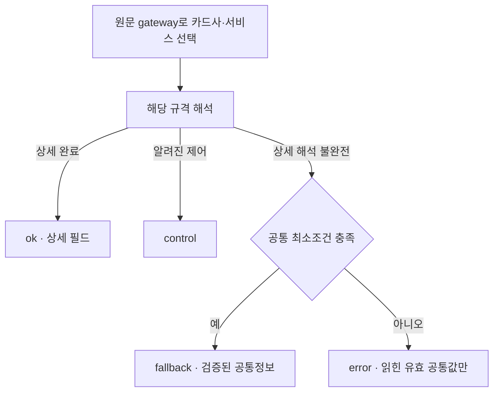

# FINAL19에서 FINAL20으로 바뀐 처리

카드사별 상세 규격과 gateway 선택 방식은 같습니다. 바뀐 것은 error의 값 보존과 최소조건에 쓰는 증거의 범위입니다.

| 항목 | FINAL19 | FINAL20 |
| --- | --- | --- |
| 공통 최소조건 미달 | error, 업무 값 전부 제거 | error 유지, 검증된 공통 값만 보존 |
| 최소조건의 식별 증거 | 해석 중 확보한 필드에서 판단 | 최종 공통 출력으로 보관 가능한 필드만 판단 |
| 농협 관리 응답 | 공통 문맥+식별 확보 시 fallback | 같은 처리 유지 |
| 금융 상세 완료 / 제어 / rest | 기존 규칙 | 기존 규칙 유지 |

금융 일반 ISO는 처리코드·금액·전송일시 3개, 관리 0800/0810은 문맥 필드 1개와 식별 필드 1개가 최소조건입니다. 고정 BC 공통 헤더 및 확인된 헤더 전용 분기는 별도 예외이므로 엑셀의 전체 공통 기준을 함께 확인합니다. 길이 숫자 하나로 정상·비정상을 결정하지 않습니다.
